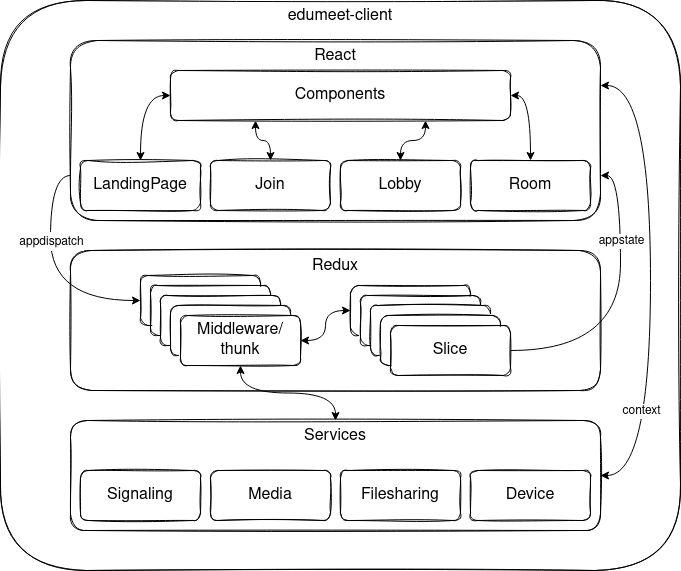

# eduMEET client guide

This is the client service for the Edumeet project.




## Usage
### Running the service in development

This will start the service using https with a self-signed certificate. It's exposed on port `4443`.
HTTPS is needed for things such as `navigator.mediaDevices.getUserMedia()`.

```bash
$ corepack enable
$ yarn install --immutable
$ yarn start
```

To run the service you need to have Node.js version 24 or higher installed. This project uses Yarn 4 via Corepack.

### Running the service in production

Build the service:
```bash
$ yarn build
```
This will produce a `./build` directory, ready to be deployed. HTTPS is needed for things such as `navigator.mediaDevices.getUserMedia()`.

You would in most cases want to replace the `config/` and `images/` directories with your own content.

https://github.com/edumeet/edumeet-docker has guidelines for running eduMEET as Docker containers.

## Configuration

See the [client configuration reference](configuration.md).

## Browser automation

See the [browser automation reference](browser-automation.md).

## Headless bots

See [headless browser and bot behavior](headless-bots.md).
